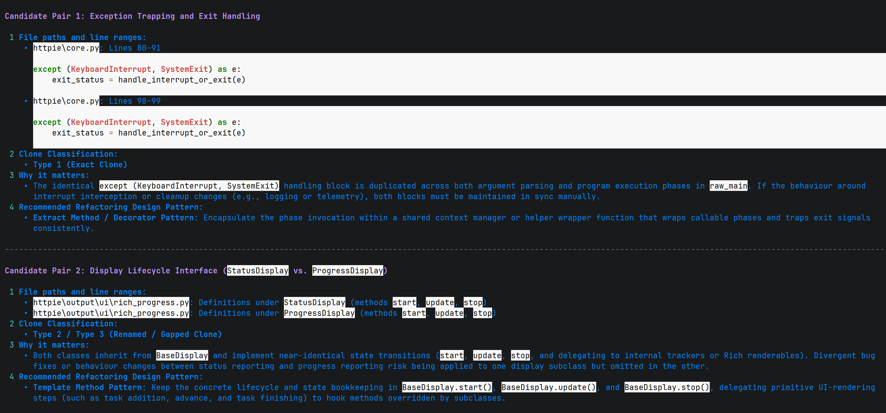
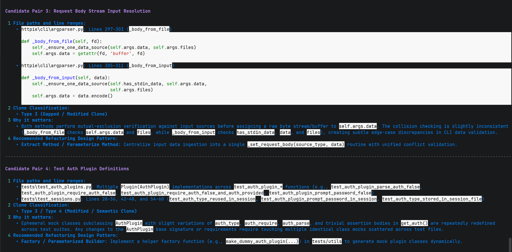
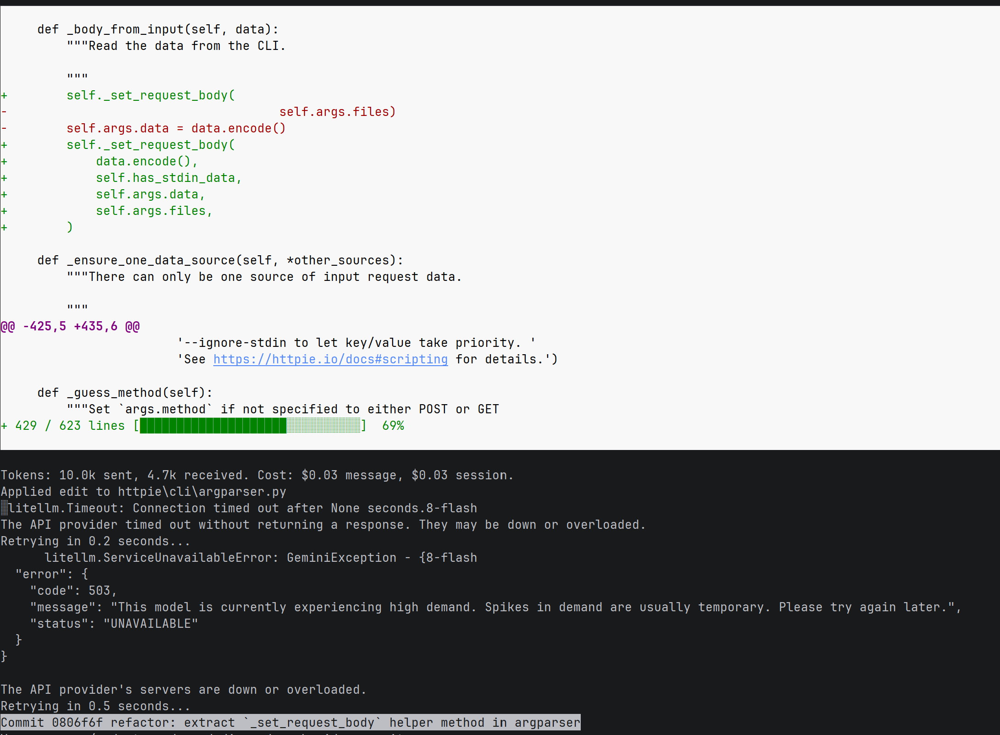
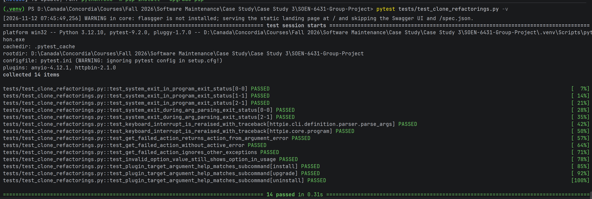
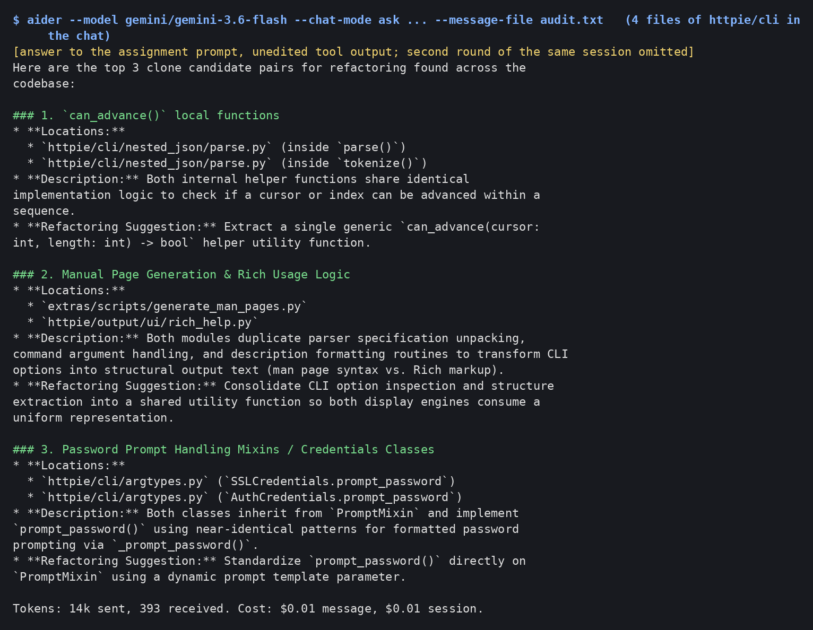
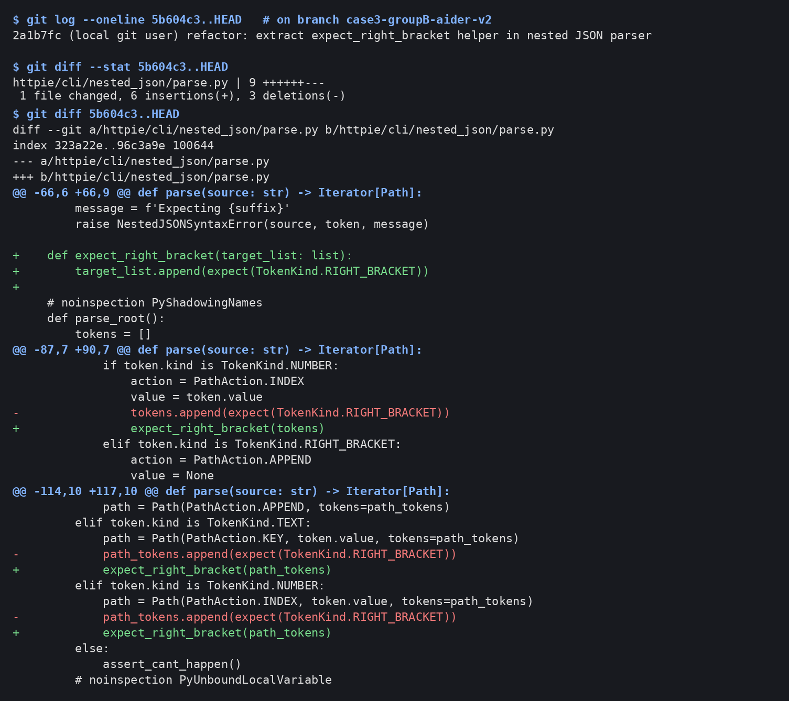
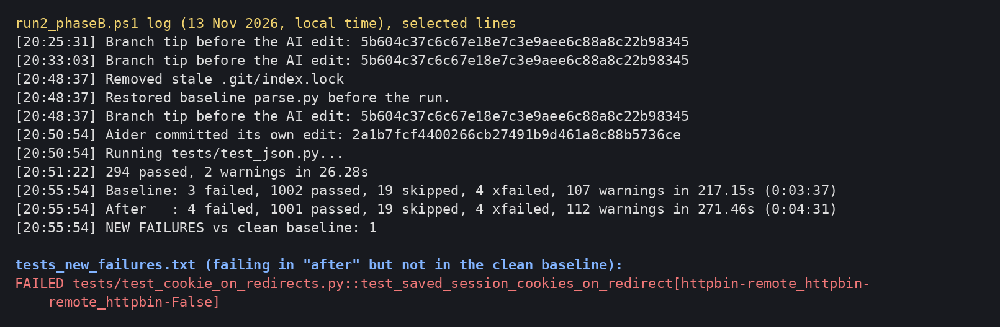

# Case Study #3, Subgroup B, Track B: second AI vendor (Aider CLI + Gemini)

Author: Yourun Lan (@Lanre-Rung). Standalone section, written so that it can be pasted into the team document without touching anyone else's text. Section numbers match the team report (v2/v3 numbering). Figures are in `figures/`.

| Part | Goes into the team report at |
|---|---|
| A. Method and cross-check (text + table) | §1.5 |
| B. Three extra rows for the clone table | §1.2 table (after C16) |
| C. Run 1 record and run 2 (prompt log, results, figures, friction) | §2.5 and §2.6 |
| D. Matrix row and paragraph | §3 (matrix) and below the §3.1 table |
| E. Audit rows AI-6 to AI-9 | §4.1 table |
| F. Contribution entry and AI usage disclosure | §5 |
| G. Evidence files | Appendix A |

---

## A. §1.5 Second AI vendor (Aider CLI + Gemini Flash): two runs and what they add to the inventory

**Method.** I made two runs with Aider CLI 0.86.2 driving Google Gemini Flash models on the same codebase, under different conditions, and the report treats them differently.

*Run 1* (11-12 Nov, gemini-3.8-flash) ran on branch `case3-groupB-aider`, which was cut from `d454613` and therefore already contained the Claude run's refactoring. Its scope was two files (`httpie/core.py`, `httpie/cli/argparser.py`), narrower than the assignment's target (`httpie/cli` and `core.py`), and its refactoring prompts named the pattern and the helper (`_set_request_body`), wording supplied by me and not by the agent. It is a useful record, but it is not an independent, unsteered run.

*Run 2* (13 Nov, gemini-3.6-flash) was made to remove those problems: a fresh clone at the HTTPie 3.2.4 baseline `5b604c3` (branch `case3-groupB-aider-v2`, nothing from the Claude run present), the audit and refactoring prompts of the assignment sheet verbatim (§5 Option 1 and the refactoring prompt, with only the [File A] / [File B] placeholders filled in), a scope fixed in advance by the assignment's target row, a test baseline recorded before any AI edit, and no hint or correction given to the agent.

The comparison with the Claude run rests on run 2; run 1 is kept where it adds evidence (C17, friction, AI-6 to AI-8).

**Run 1: four candidates, four different fates.** Pair 2 (StatusDisplay vs ProgressDisplay in `rich_progress.py`) points at the same pair as C12 and recommends the same Template Method, but the agent never had the file in its context (it was declined) and described the pair from the repository map; its claim that start, update and stop all share rendering hooks overreaches, because only `stop()` is duplicated (AI-8). It is a partial hit and not an independent confirmation. Pair 1 is C01 seen after the refactoring (the branch already contained it), so it reports the residual duplication of the two call sites, not a new clone. Pair 3, `_body_from_file` vs `_body_from_input` in `argparser.py` (lines 382-397 at the baseline), is in none of C01-C16: it is recorded as C17 and it is the pair run 1 refactored. Pair 4 is real duplication in `tests/`, which §1.1 excluded from the scope, so it stays a finding and not a task.

**What the two runs are worth.** Run 2, the clean one, raised the three pairs the assignment prompt asks for. (1) `can_advance()` in `nested_json/parse.py`: two local functions of two lines each (`parse.py:42-43` and `162-163`), real but tiny (C18). (2) `SSLCredentials.prompt_password` vs `AuthCredentials.prompt_password` in `argtypes.py` (154-155 vs 164-165), real but tiny (C19). (3) `generate_man_pages.py` vs `rich_help.py`: neither file was in the agent's context when it made the claim and neither lies in the scope of the batch, so the claim is unverified (AI-9). None of the three is one of C01-C16, so the overlap of run 2 with the Claude inventory is 0 of 16; the two clones C02 and C03 that sit in `argparser.py` were not reported even though the file was in the agent's context (the prompt asks for the top 3 only, which limits what it could report). The real pairs it found are far smaller than C01-C16 (2 lines against 9 to 46 lines): an unsteered top-3 audit by a Flash-class model surfaced small local duplication, while the larger cross-function clones stayed unreported.

Run 1 raised, on the two files it was given, one new clone (C17), one re-read of already-refactored code (C01) and one partially hallucinated description around a real pair (C12). Its overlap with the Claude inventory was 1 of 16 pairs (C12, partial); that number measures how little two audits overlap, not recall, because the set of true clones is unknown. The three runs together give 19 verified pairs (C01-C19), and no single run produced more than 17 of them; a single AI audit leaves clones behind by construction. Run 1 printed line ranges that are all wrong while every code fragment it quoted is verbatim correct (AI-6, AI-7); run 2 printed no line ranges at all.

**Cross-check table**

| Aider + Gemini candidate | Claude Code equivalent | Cross-check result | Coordinates in the answer |
|---|---|---|---|
| Run 1 - core.py exit handlers (residual) | C01 (refactored) | Same clone, but reported on already-refactored code: the handlers are extracted and the two call sites remain identical | 2 line ranges stated, both wrong (~23 lines off); the quoted code is verbatim correct |
| Run 1 - rich_progress.py displays | C12 (backlog) | Same pair and same pattern (Template Method), but a partial hit: this agent never opened the file and its description of start/update/stop overreaches; only stop() is duplicated (AI-8) | no line range stated |
| Run 1 - argparser.py body resolution | not reported -> C17 | New clone. Refactored by the agent in commit 0806f6f | 2 line ranges stated, both wrong (~104 lines off); the quoted code is verbatim correct |
| Run 1 - auth-plugin mocks in tests/ | out of scope | Real duplication (several Plugin(AuthPlugin) mocks), outside the §1.1 scope | 3 line ranges stated, all wrong (~244 lines off); the cited files were never read |
| Run 2 - can_advance() in nested_json/parse.py | not reported (C18) | Real. Two local functions, `parse.py:42-43` and `162-163` at 5b604c3: `return cursor < len(tokens)` vs `return cursor < len(source)`. Two lines each, so the suggested shared helper is plausible but trivial | none stated |
| Run 2 - SSLCredentials.prompt_password vs AuthCredentials.prompt_password (argtypes.py) | not reported (C19) | Real. `argtypes.py:154-155` vs `164-165`, one-line bodies that differ in the prompt text; both classes inherit PromptMixin, as the agent said. Tiny | none stated |
| Run 2 - generate_man_pages.py vs rich_help.py | not reported | Unverified (AI-9). Neither file was in the agent's context when it made the claim; both consume ParserSpec to render help, but no shared block was identified or measured in this study | none stated |

---

## B. Rows for the §1.2 clone table (after C16)

Line ranges are at 5b604c3. The token scanner was not run on these (they were found after the scan).

| ID | Clone pair: files, line ranges, description | Size | Type | Token cross-check | AI (Claude) | Disposition |
|---|---|---|---|---|---|---|
| C17 | `httpie/cli/argparser.py:382-389` ↔ `argparser.py:391-397`. `_body_from_file()` vs `_body_from_input()`: `_ensure_one_data_source(...)` then assign `self.args.data` (found by Aider run 1) | 8 / 7 ln (tokens not measured) | Type 3 | not measured | No (the Claude run missed it) | Refactored by Aider run 1 (commit 0806f6f) / Extract Method |
| C18 | `httpie/cli/nested_json/parse.py:42-43` ↔ `parse.py:162-163`. `can_advance()` local functions in `parse()` and `tokenize()` (found by Aider run 2) | 2 / 2 ln | Type 2 | not measured | No | Backlog / trivial. Run 2 refactored a different repetition in this file; this pair is unchanged |
| C19 | `httpie/cli/argtypes.py:154-155` ↔ `argtypes.py:164-165`. `SSLCredentials.prompt_password()` vs `AuthCredentials.prompt_password()`: one-line bodies that differ in the prompt text (found by Aider run 2) | 2 / 2 ln | Type 2 | not measured | No | Backlog / trivial; both classes already share `PromptMixin._prompt_password()` |

---

## C. §2.5 and §2.6 Second vendor: run 1 (record) and run 2 (clean)

### 2.5 Second vendor, run 1: Aider CLI + Gemini 3.8 Flash (C17; scoped and prompted by me, kept as a record)

**Status of run 1.** This run used branch `case3-groupB-aider`, which already contained the Claude run's refactoring (cut from `d454613`), a two-file scope, and refactoring prompts that named the pattern (Extract Method / Parameterize Method) and the helper (`_set_request_body`). It is kept as a record and for its evidence (C17, the friction below, AI-6 to AI-8). The clean comparison is run 2 (§2.6).

| Item | Value |
|---|---|
| Host | Windows 11, Python 3.12.10, project virtualenv, Aider 0.86.2 |
| Model | gemini/gemini-3.8-flash via the Google AI API; ask edit format for the audit, whole edit format for the patch |
| Session 1, audit | 2026-11-11 23:36 to 23:52. Context: `httpie/core.py` + `httpie/cli/argparser.py` (11k tokens). 4 candidates |
| Session 2, patch | 2026-11-12 08:05 to 08:41. Context: `argparser.py` (10k tokens). Output: whole-file reply, 4.7k tokens |
| Output | commit `0806f6f`: `_set_request_body()` extracted in `HTTPieArgumentParser`, both callers delegate (+15/-5). Aider committed it itself (auto-commits) |
| Verification | Reading the diff only. The 14 regression tests of the Claude run do not touch these functions (see the last paragraph below) |

**Prompt log** (full transcript in `case3_trackB/aider_prompt_log.md`)

| # | Prompt as typed | Agent action | Result |
|---|---|---|---|
| 1 | "Scan these files for duplicate functions, near-identical logic blocks, or semantic code clones..." (the audit prompt of the assignment, scope narrowed to the two files in the chat) | Read both files, grouped the code into 4 candidate pairs, typed each pair, recommended a pattern | 4 candidates (Figures B6, B7); nothing written to disk |
| 2 | "Refactor Candidate Pair 3 ... using the Extract Method / Parameterize Method pattern. Show the complete before/after code diff." | 7 provider failures over ~4 minutes (503, peer closed connection, "Deadline expired"), absorbed by Aider's own backoff 0.2 -> 8.0 s, then a unified diff | The `_set_request_body` diff on screen only: ask mode never writes (F1) |
| 3 | `/chat-mode code`, `/add httpie/cli/argparser.py`, then "Refactor the duplicate logic between `_body_from_file` and `_body_from_input` ... Apply the changes directly to the file." | Re-emitted the whole 623-line file, wrote it, auto-committed it | commit `0806f6f` "Applied edit to httpie\cli\argparser.py" (Figure B8) |

**Friction observed in this run.** Three of the seven recorded items matter here. (1) An ask-mode session produces a diff that never reaches the disk, so the git commands that follow it correctly report "no changes added to commit"; the fix is `/chat-mode code`, not a second analysis. (2) Gemini on this endpoint failed seven times in a row on a 20k-token context and answered reliably on a 10k-token one, with Aider's exponential backoff absorbing the retries. (3) The whole edit format re-emits the entire file to change 15 lines (4.7k output tokens); a diff format costs a fraction of that. None of it is a correctness problem and all of it is recorded rather than cleaned up (`aider_prompt_log.md`, F1-F7).

*Figure B6: Clone discovery, run 1 (Aider + Gemini). Candidates 1 and 2 of 4 as printed by the agent: the two exit-handler call sites in core.py (C01, already refactored) and StatusDisplay vs ProgressDisplay (C12). Pair 1 holds as residual duplication and pair 2 only partly (AI-8); the line ranges printed with them do not hold (AI-6).*

*Figure B7: Clone discovery, run 1. Candidates 3 and 4: `_body_from_file` vs `_body_from_input` (C17, absent from the Claude run and the clone run 1 then refactored) and the auth-plugin mocks in tests/ (real, but outside the assessed scope).*

*Figure B8: Patch applied by the agent and committed by the agent (run 1, patch session). Aider rewrote `httpie/cli/argparser.py` in whole edit format, printed "Applied edit" and committed it as 0806f6f. The timeout and 503 "Retrying" lines below belong to this patch session, not to the audit session.*

*Figure B9: Regression run for run 1. `pytest tests/test_clone_refactorings.py -v` -> 14 passed in 0.31 s. The run is time-stamped 2026-11-12 07:45, before the patch session (08:05-08:41), so it shows the C01-C04 tests passing on the tree the agent started from; it is not a test of the C17 edit.*

**What the 14 tests do and do not cover.** `tests/test_clone_refactorings.py` pins the C01-C04 paths; it does not touch `_body_from_file` or `_body_from_input`. Those two are exercised by `tests/test_uploads.py` and `tests/test_binary.py`, which need optional test dependencies that my virtualenv for run 1 did not carry. C17 is therefore verified by reading the diff only: the 14 regression tests do not touch it, and the run in Figure B9 pre-dates the patch session. The diff keeps the argument list of `_ensure_one_data_source()` and the order of the successful path unchanged, but it moves two evaluations (`getattr(fd, "buffer", fd)` and `data.encode()`) in front of the mutual-exclusion check: for a stdin payload that is not encodable and collides with another data source at the same time, the error reported would now be `UnicodeEncodeError` instead of the argparse error. No test covers that combination. It is recorded as residual risk (§4.2).

### 2.6 Second vendor, run 2: clean-baseline audit and refactoring (Aider CLI + Gemini 3.6 Flash)

**Set-up and rules.** A fresh git clone of the fork at the HTTPie 3.2.4 baseline (5b604c3) in a separate folder, branch `case3-groupB-aider-v2`, a new virtualenv with HTTPie and its test dependencies, Windows 11, Python 3.12, Aider 0.86.2. The test suite was run before any AI edit: 3 failed, 1002 passed, 19 skipped, 4 xfailed in 217 s. The 3 failures exist without any change: `tests/test_cli_ui.py::test_naked_invocation[args3-...]` and two `tests/test_encoding.py` big5 charset tests. Rules fixed before the run: (1) the two prompts are those of the assignment sheet, verbatim; (2) the agent gets no hint, correction or example, and nothing from the Claude run or from run 1; (3) failures and hallucinations are recorded, not repaired; (4) the scope is `httpie/cli/` and `httpie/core.py`, the target row of the assignment (16 files). The model is gemini-3.6-flash because gemini-3.8-flash and 3.7-flash were rate-limited or failing on 13 Nov (F-R2 below); the same model is passed as the weak model so that no call is routed to another one.

**Prompt log** (transcripts in `run2_evidence/`)

| # | Prompt as typed | Agent action | Result |
|---|---|---|---|
| 1 | "Scan the codebase for duplicated functions, near-identical logic blocks, or semantic clones across modules. Identify the top 3 clone candidate pairs for refactoring." (assignment §5 Option 1, verbatim). First tried on all 78 files of `httpie/` in one request | Five attempts (gemini-3.8-flash three times, 3.7-flash, 2.5-pro) failed with rate-limit errors (429, tokens per minute and then 20 requests per day) and 503 "high demand" | no answer (F-R1); scope split into 3 batches of the 16 files in scope |
| 2 | The same prompt, batch 1 of 3 (`httpie/cli/__init__.py`, `argparser.py`, `argtypes.py`, `constants.py`), ask mode | Completed on gemini-3.6-flash after a timeout on 3.7-flash: 14k tokens sent, 393 received. Because of `--yes-always`, Aider then accepted its own request to add three more files (`extras/scripts/generate_man_pages.py`, `httpie/cli/nested_json/parse.py`, `httpie/output/ui/rich_help.py`) and answered that they were "already sufficient" (20k sent, 92 received) | 3 candidates, no line numbers (Figure B10). Batches 2 and 3 did not complete (503 / limits), so the audit is partial: 4 of the 16 in-scope files, plus the 3 added by the agent |
| 3 | "Refactor the clone pair between httpie/cli/nested_json/parse.py and httpie/cli/nested_json/parse.py by extracting common logic into a shared helper/base method. Apply changes and verify unit tests." (assignment refactoring prompt; the pair is the agent's own candidate 1 and lies inside one file, so both placeholders hold the same path) | Aider in code mode, whole-file edit format, `parse.py` in the chat, no tests configured. Two launches were first rejected at the command line (an invalid option, a set-up error of mine) before reaching the model. Attempts 1 and 2 then ran with a stale lock file in the repository: the agent proposed a helper `_parse_path_item` and then a second helper `_parse_bracket_content` on top of the first; the edits were written to the file but Aider could not commit them, so the file was restored and both transcripts archived. Attempt 3 (clean, from the baseline): committed by Aider | Commit `2a1b7fc`: `parse.py` +6/-3, new helper `expect_right_bracket()` (Figure B11). Tests in Figure B12 |

**Audit.** The agent named three pairs (Figure B10). Two are real and tiny (C18, C19), one is unverified because the agent had not read either file (AI-9). Its refactoring suggestions are one-liners (a shared `can_advance()`, a `prompt_password()` on `PromptMixin`). It did not report C02 or C03, although `argparser.py` (24 KB) was in its context, and its second round shows how `--yes-always` works: Aider asked for files and the flag said yes to everything.

**Refactoring.** The committed change is a three-line nested function `expect_right_bracket(target_list)` next to `expect()` inside `parse()`, and it replaces three copies of `tokens.append(expect(TokenKind.RIGHT_BRACKET))`. The call, the order and the list appended to are the same, so it preserves behaviour by inspection. It is a micro-extraction: the file grows by 3 lines, and it does not touch `can_advance()`, the pair that the agent's own audit named first. The same prompt gave three different refactorings in three attempts (a 20-line `_parse_path_item`, then a second helper on top of it, then this 3-line helper), so the outcome is not reproducible.

**Tests.** Aider did not run the tests (no test command was configured, so "verify unit tests" stayed a request); my script ran them afterwards. `tests/test_json.py`, which covers this parser: 294 passed. Full suite after the edit: 4 failed, 1001 passed, 19 skipped, 4 xfailed (271 s), against 3 failed, 1002 passed (217 s) before. The three baseline failures recur. The one new failure, `tests/test_cookie_on_redirects.py::test_saved_session_cookies_on_redirect[httpbin-remote_httpbin-remote_httpbin-False]`, uses `remote_httpbin`, a live network service, and has nothing to do with the nested-JSON parser. Re-running the whole file `tests/test_cookie_on_redirects.py` on the refactored tree gave 21 passed in 6.25 s (terminal output, not saved as a file). It is classified as a flaky network test and not as a regression: no regression attributable to the refactoring was found, and no behaviour change was tested beyond what the existing suite covers.

*Figure B10: Run 2 audit, batch 1. The agent's answer to the assignment prompt: three candidate pairs and no line numbers. Text capture of the tool output (`run2_evidence/audit_b1_try2.txt`), rendered as an image by a script; none of the text was typed by hand.*

*Figure B11: Run 2 patch as committed by Aider (2a1b7fc, +6/-3 in parse.py). Text capture of the commit, stat and diff files saved by the script (`refactor_commits.txt`, `refactor_stat.txt`, `refactor.diff`), rendered as an image.*

*Figure B12: Run 2 test result against the clean baseline. Selected lines of the script log (`phaseB_log.txt`) and the file of failures that are not in the baseline (`tests_new_failures.txt`), rendered as an image. The re-run that cleared the one new failure is described in the text.*

**Friction and failures recorded in run 2**

- **F-R1, coverage:** the whole package (78 files) in one request failed five times on the free tier (250k input tokens per minute, 20 requests per day per model, 503 errors); a failed Aider run also spends about nine requests on its own retries. A paid prepay was declined. The scope was split into batches and only batch 1 of 3 completed, so the audit covers 4 of the 16 in-scope files plus the 3 the agent requested.
- **F-R2, model drift:** gemini-3.8-flash returned errors on every probe on 13 Nov and 3.7-flash timed out or returned 503, so run 2 used gemini-3.6-flash while run 1 used 3.8-flash; the two runs differ in model as well as in conditions. The first batch also leaked into another model's quota until the weak model was set to the same model.
- **F-R3, `--yes-always`:** it auto-accepted the agent's requests to add files, which is why the second round of the audit contains three files outside the batch and, for two of them, outside the scope. It also opened error pages in the browser until a no-op browser command was configured.
- **F-R4, a stale lock:** attempts 1 and 2 of the refactoring could not be committed because an empty `.git/index.lock` was left in the repository by a read-only git command run on the shared folder while the run was being prepared. It is a set-up error and is not attributed to the agent.
- **F-R5, whole-file edit format:** Aider's default for this model re-emits the whole file; the diff it shows is still small, but the cost per attempt is the size of the file.
- **F-R6, not reproducible:** three attempts at the same prompt gave three different refactorings (see Refactoring above); none was selected by hand, the clean attempt is the one the script kept.

---

## D. §3 Comparative evaluation

**Row to add to the §3 matrix**

| Evaluation metric | Track A: Traditional static tools (PMD/CPD) | Track B: Agentic AI / GenAI | Winner & justification (Track B assessment) |
|---|---|---|---|
| Second AI vendor (Aider CLI + Gemini Flash), clean run 2 | Reserved for Subgroup A (PMD/CPD results) | Assignment prompts verbatim, scope `httpie/cli` + `core.py`, clean baseline. Audit: 3 candidates, 2 real but 2 lines each, 1 unverified; 0 of the 16 Claude clones re-found; C02 and C03 missed although the file was in context. Only 1 of 3 batches completed. Refactoring: 1 commit, +6/-3 lines (`expect_right_bracket`); 294/294 JSON tests pass; full suite 3 baseline failures plus 1 network-flaky test that passes on re-run. Friction: 5 failed whole-package attempts, rate limits and 503 errors, model drift from 3.8 to 3.6, three different refactorings from three attempts. | Track B Claude (provisional). A Flash-class Aider run is cheap and quick but shallow: it surfaced tiny local duplication, a micro-refactoring and one unsupported claim; the Claude run's larger clones were not found. Both need the same human check. |

**Paragraph for below the §3.1 table.** *Second vendor, two runs (§1.5).* Run 2, the clean one, overlaps the Claude inventory on 0 of 16 clones and adds two real two-line pairs (C18, C19) and one unverified claim; run 1 overlaps on 1 of 16 (C12, partially, with an over-reaching description) and adds C17. The overlap numbers measure how little the audits agree, not recall. Neither the Claude run nor run 2 invented a file, a function or a line range in a way we could find; run 1 printed wrong line ranges (AI-6, AI-7), and both Aider runs made claims about files they had not read (AI-8, AI-9). The reconciliation that produced C17 and the check of C18 and C19 is human work: that is the cost of relying on one vendor, and the reason §4.3 keeps a deterministic scan as the gate.

---

## E. §4.1 rows for the false-positive and hallucination audit

Intro sentence for the table: *Rows AI-6 to AI-8 are errors of Aider run 1 and AI-9 is an error of Aider run 2 (Aider CLI + Gemini); all four were found the same way, by checking its output against the source.*

| # | Source | Claim | Ground truth (verified in source) | Verdict |
|---|---|---|---|---|
| AI-6 | AI (Aider run 1), coordinates | Line ranges printed for the four candidates: core.py 80-91 / 98-99, argparser.py 297-303 / 305-311, test_sessions.py 28-36 / 42-48 / 54-60. | Checked with `git show 869f1c7:httpie/cli/argparser.py` (the state of the files when that session ran): the call sites are at core.py 103-104 and 112-113, `_body_from_file` at 401-406, `_body_from_input` at 410-416, and the test_sessions.py ranges hold SessionTestBase / CookieTestBase helpers (the cited tests are at 272, 306 and 346). Every quoted code fragment is verbatim correct; every coordinate is wrong. | Hallucinated coordinates (3 of 3 pairs that had them), correct code. Re-derived from git before use |
| AI-7 | AI (Aider run 1), scope | Auth-plugin mocks in tests/test_auth_plugins.py and tests/test_sessions.py as a Type 3/4 clone cluster, recommended for a parameterised factory. | The duplication is real (several `class Plugin(AuthPlugin)` mocks with one-line variations), but tests/ was excluded from the audit scope in §1.1, and the agent proposed it without having read the files. | Out-of-scope report. Recorded, not actioned |
| AI-8 | AI (Aider run 1), claim about an unread file | Pair 2: StatusDisplay and ProgressDisplay duplicate start / update / stop and can share a Template Method with rendering hooks (`rich_progress.py`, no line numbers). | The agent had declined to add `rich_progress.py`, so it reasoned from the repository map. Only `stop()` is a near-clone (`rich_progress.py:86-94` vs `132-141`, C12); `start()` and `update()` share a signature and nothing else (a spinner status against a progress bar). | Partial hallucination around a real pair; not counted as an independent confirmation of C12 |
| AI-9 | AI (Aider run 2), claim about unread files | Pair 2: `extras/scripts/generate_man_pages.py` and `httpie/output/ui/rich_help.py` duplicate parser-spec unpacking, argument handling and description formatting; consolidate them in a shared utility. | Neither file was in the agent's context when it made the claim (Aider's own file request was auto-accepted afterwards), and both lie outside the batch it was given. Both consume ParserSpec to render help (man page vs terminal), but no shared extractable block was identified or measured in this study. | Unsupported claim (unverified); recorded, not actioned |

Sentence to adjust in the §4.1 "Observation" paragraph: *The Claude Code agent, which read files with tools, did not invent a file path, a function or a line range in this study; the Aider agent printed wrong line ranges in run 1 and made claims about files it had not read in both runs (AI-6 to AI-9).*

---

## F. §5 contribution entry and AI usage disclosure

**Yourun Lan, @Lanre-Rung, student ID 40366978.** Subgroup B, Track B (Agentic AI), second vendor. Run 1 (11-12 Nov): Aider CLI 0.86.2 + gemini-3.8-flash over `httpie/core.py` and `httpie/cli/argparser.py`; 4 candidates, C17 refactored (commit 0806f6f); scoped and prompted by me, so it is kept as a record and not as the independent run (§1.5, §2.5). Run 2 (13 Nov): clean clone at 5b604c3, assignment prompts verbatim, gemini-3.6-flash; audit with 3 candidates (batch 1 of 3) and refactoring (commit 2a1b7fc), tests against the clean baseline (§2.6, Figures B10-B12). Cross-checked both runs against the Claude run and audited their errors (§4.1 AI-6 to AI-9).

- Run 1 branch: https://github.com/ABCWarrior/SOEN-6431-Group-Project/tree/case3-groupB-aider
- Run 1 commit: https://github.com/ABCWarrior/SOEN-6431-Group-Project/commit/0806f6fd37de55be7bae18bd4dbe637a5f9166f2
- Run 2 branch: https://github.com/ABCWarrior/SOEN-6431-Group-Project/tree/case3-groupB-aider-v2
- Run 2 commit: https://github.com/ABCWarrior/SOEN-6431-Group-Project/commit/2a1b7fcf4400266cb27491b9d461a8c88b5736ce
- Run 2 pull request (#7, open, not merged): https://github.com/ABCWarrior/SOEN-6431-Group-Project/pull/7
- Role rotation evidence (Track A in Case Study #2): https://github.com/ABCWarrior/SOEN-6431-Group-Project/commit/77dae91c9b4ef8e51308526121caf09963ce52ff

**Sentences to add to the AI tool usage disclosure** (and replace "No commit, push, issue or pull request was made by the agent" with "The Claude Code agent made no commit, push, issue or pull request"): I ran Aider CLI 0.86.2 with Google Gemini Flash models (gemini-3.8-flash in run 1, gemini-3.6-flash in run 2) on the assignment prompts, and used other AI assistants (Google Gemini, DeepSeek, and Claude in a chat session) to plan run 2, to check the Aider output against the source and the tests, and to revise this section. Aider committed its own edits through its auto-commit (0806f6f in run 1, 2a1b7fc in run 2, both with a Co-authored-by trailer for Aider); the pushes and pull requests are human. All claims about the Aider runs were checked against the source and the transcripts, and its errors are listed in §4.1 (AI-6 to AI-9).

---

**CI note for §2.4 / §2.6.** GitHub Actions on the fork reported failures on all jobs within 5 to 12 s of starting (code style and the Python 3.7, 3.8 and 3.9 test jobs). The runs were not inspected; the local test results of §2.6 are the evidence used in this report.

---

## G. Evidence files (Appendix A)

| Path | Content |
|---|---|
| `aider_prompt_log.md`, `figures/figB6...figB9 *.png` | Aider run 1: prompts, candidates, verification, friction log (F1-F7), commits; Figures B6 to B9 |
| `run2_evidence/` (not in the repository) | Aider run 2: `tests_baseline.txt`, `audit_b1_try1/2.txt`, `audit_whole_try1-5.txt` (failed whole-package attempts), `refactor_try1.txt` (clean attempt) and the two archived earlier attempts, `refactor.diff`, `refactor_commits.txt`, `tests_after.txt`, `tests_new_failures.txt`, `phaseA2_log.txt`, `phaseB_log.txt`, `figB10-B12 *.png` |
| `run2_phaseA2.ps1`, `run2_phaseB.ps1`, `run2_prompts/` | Scripts and verbatim prompts of run 2 (audit, refactoring) |
