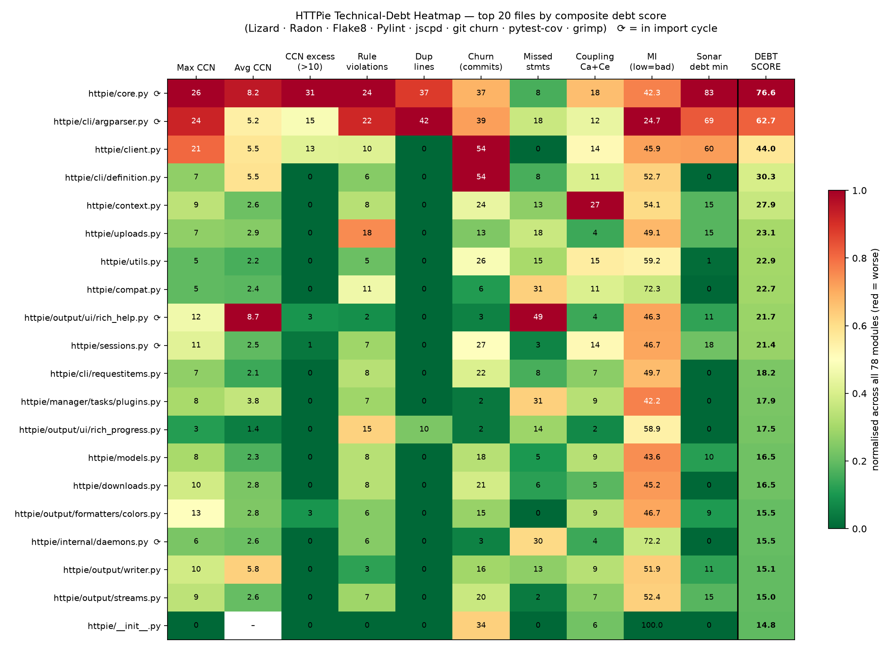
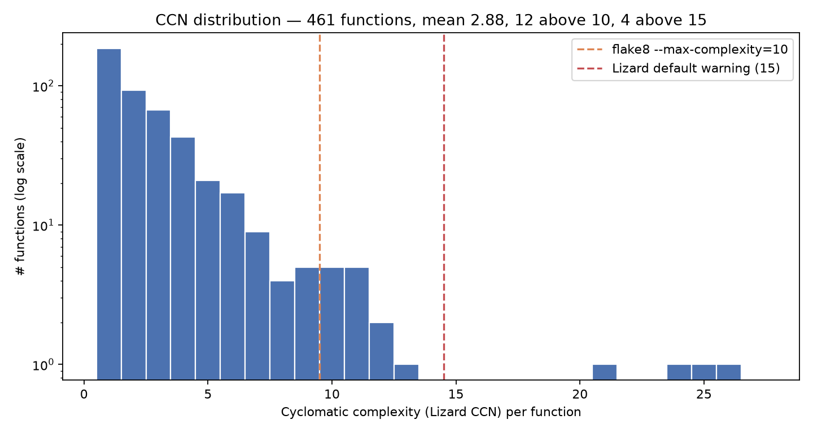
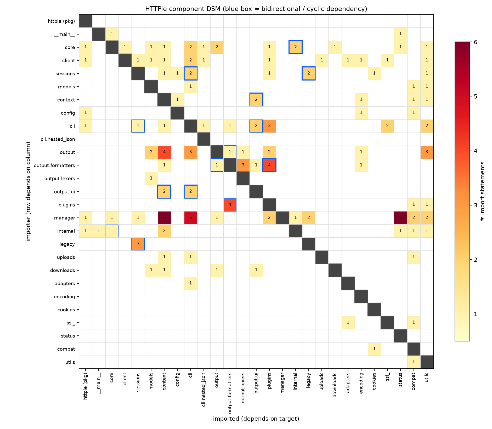
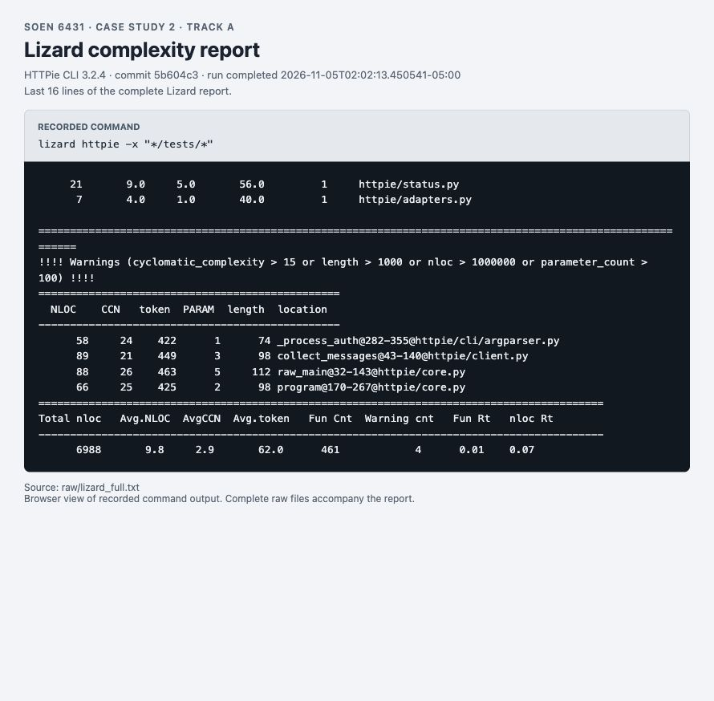
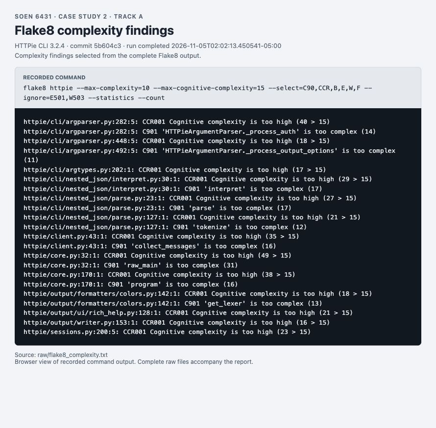
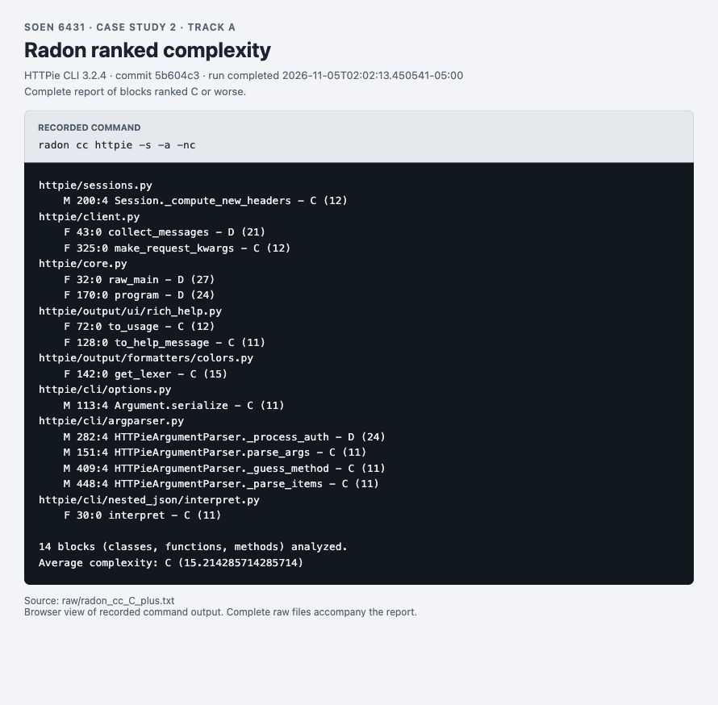
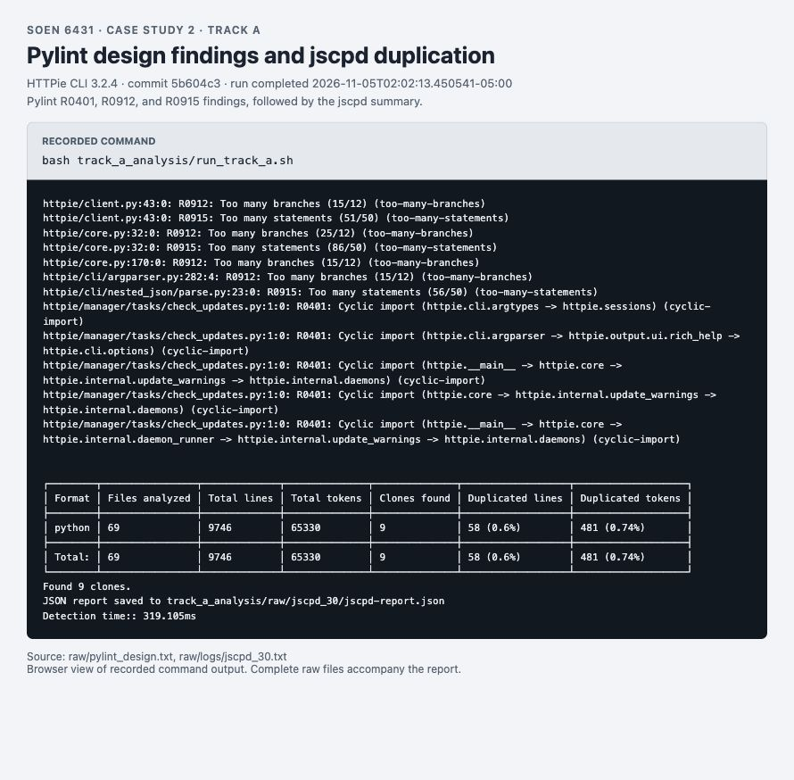
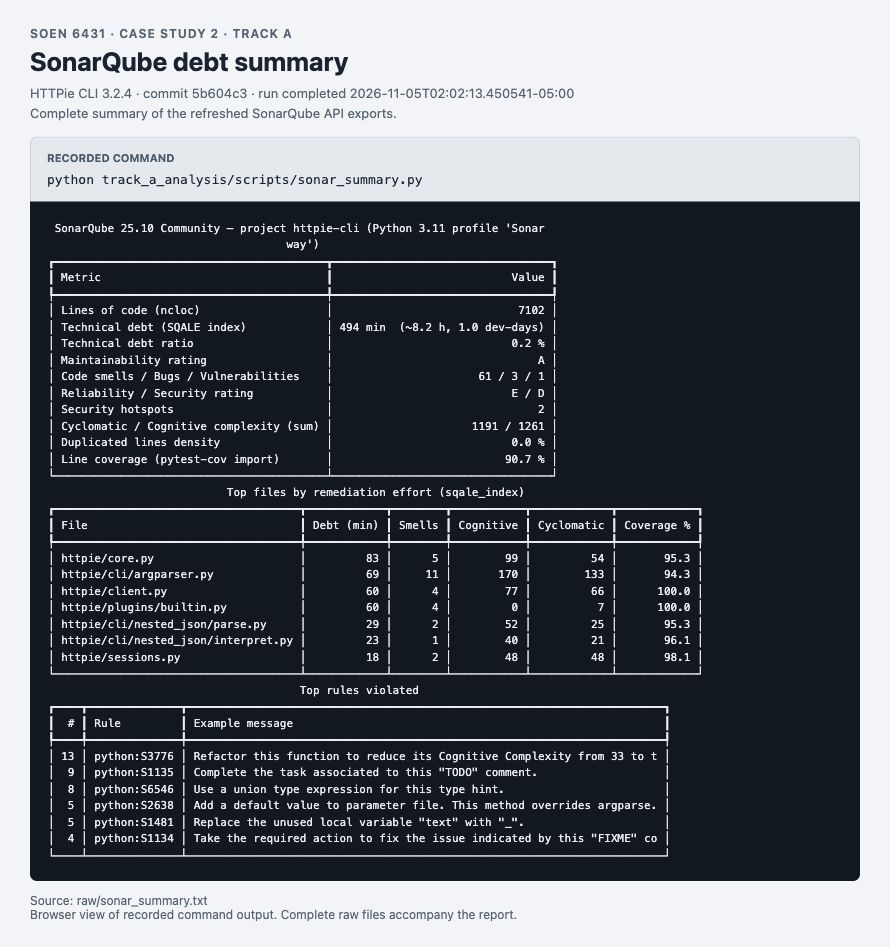
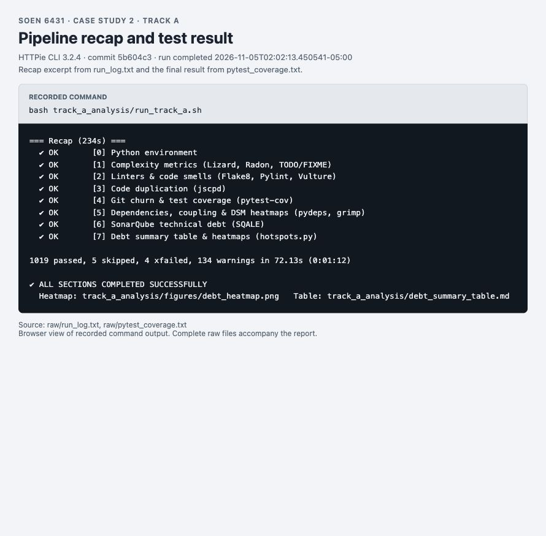

# Case study 2 technical debt analysis of HTTPie CLI

SOEN 6431. Track A contribution, updated November 5, 2026.

This report follows the five sections in the assignment's Submission Deliverables. Track A identifies `httpie/core.py`, `httpie/cli/argparser.py`, and `httpie/client.py` as the highest-priority maintenance hotspots. The analysis combines complexity, duplication, change history, coverage, rule findings, and import dependencies.

Track A evidence is complete for this run. Track B results and student identities were not supplied. The comparison and contribution sections mark those gaps for the group's final PDF.

## Section 1: Technical Debt Inventory & Hotspot Analysis

### 1.1 Target and verified baseline

The target is HTTPie CLI 3.2.4 on branch `Case2-groupA`, commit `5b604c37c6c67e18e7c3e9aee6c88a8c22b98345`. Static metrics cover the `httpie/` production package. The existing change to `tests/test_encoding.py` is present in the tested working tree.

| Baseline | Fresh result |
|---|---:|
| Production modules | 78 |
| Physical lines of code, Radon | 9,817 |
| Source lines of code, Radon | 7,039 |
| Functions, Lizard | 461 |
| Average cyclomatic complexity, Lizard | 2.88 |
| Functions with Lizard CCN greater than 10 | 12 |
| Functions with Lizard CCN greater than 15 | 4 |
| Line coverage, pytest-cov | 90.7% |
| Regression result | 1,019 passed, 5 skipped, 4 expected failures |

The analysis completed on November 05, 2026 at 02:02 -0500. The updated pipeline runs `pytest tests` with `--override-ini=addopts=`, which disables the configured doctests. Its count therefore differs from the previous report's 1,027 tests plus doctests. Coverage includes 3,798 of 4,187 executable statements, with 389 missed. This run measures line coverage, so it does not establish branch coverage.

Evidence is available in the [run log](raw/run_log.txt), [run metadata](raw/run_metadata.json), [pytest output](raw/pytest_coverage.txt), and [coverage data](raw/coverage.json).

### 1.2 Debt heatmap and summary table

| Rank | Module | LOC | Average CCN | Maximum CCN | Rule findings | Coverage | Debt score |
|---|---|---:|---:|---:|---:|---:|---:|
| 1 | `httpie/core.py` | 298 | 8.2 | 26 | 24 | 95.3% | 76.6 |
| 2 | `httpie/cli/argparser.py` | 613 | 5.2 | 24 | 22 | 94.3% | 62.7 |
| 3 | `httpie/client.py` | 400 | 5.5 | 21 | 10 | 100.0% | 44.0 |
| 4 | `httpie/cli/definition.py` | 956 | 5.5 | 7 | 6 | 92.6% | 30.3 |
| 5 | `httpie/context.py` | 217 | 2.6 | 9 | 8 | 89.2% | 27.9 |
| 6 | `httpie/uploads.py` | 269 | 2.9 | 7 | 18 | 86.2% | 23.1 |
| 7 | `httpie/utils.py` | 309 | 2.2 | 5 | 5 | 88.5% | 22.9 |
| 8 | `httpie/compat.py` | 113 | 2.4 | 5 | 11 | 44.6% | 22.7 |
| 9 | `httpie/output/ui/rich_help.py` | 230 | 8.7 | 12 | 2 | 52.9% | 21.8 |
| 10 | `httpie/sessions.py` | 322 | 2.5 | 11 | 7 | 98.1% | 21.4 |

LOC means physical file lines from Radon. CCN means Lizard cyclomatic complexity. Rule findings combine Flake8 and Pylint, excluding Pylint's missing-docstring rules `C0114`, `C0115`, and `C0116`. Findings from different tools can overlap.

The [generated summary table](debt_summary_table.md) contains the top 15 modules and additional metrics. Its `NLOC (in funcs)` column counts non-comment lines inside functions, so it differs from LOC above. The [complete CSV](raw/debt_summary_by_file.csv) contains all 78 modules.



The [aggregation script](scripts/hotspots.py) normalizes six signals across the 78 modules and calculates a relative priority score:

```text
Debt score = 100 × (
	0.30 × normalized complexity excess
	+ 0.20 × normalized change count
	+ 0.15 × normalized missed statements
	+ 0.15 × normalized rule findings
	+ 0.10 × normalized clone-occurrence lines
	+ 0.10 × normalized import coupling
)
```

Complexity excess sums `max(0, CCN - 10)` over a file's functions. Change count is the number of non-merge commits touching the file since January 1, 2019. Import coupling adds incoming and outgoing module dependencies. Min-max normalization subtracts the minimum and divides by the observed range. A constant signal contributes zero.

The score ranks modules within this checkout. It is not a probability of failure or an estimate of repair time. SonarQube debt appears in the heatmap as a separate measurement and does not enter the score.

The duplication input sums both occurrences of each clone pair, including overlapping matches. Its 123 lines across files are not 123 unique duplicated lines. jscpd's own project summary reports 58 duplicated lines, or 0.6%. Churn also includes routine edits, so a high change count does not by itself prove design debt.

### 1.3 The three highest-priority hotspots

1. **`httpie/core.py`, score 76.6.** `raw_main()` has Lizard CCN 26, and `program()` has CCN 25. The module combines argument handling, error handling, request execution, output, and downloads. Repeated exception handlers contribute 37 clone-occurrence lines. The file has 37 historical changes, 95.3% line coverage, and 83 minutes of SonarQube remediation effort.
2. **`httpie/cli/argparser.py`, score 62.7.** `_process_auth()` has Lizard CCN 24 and cognitive complexity 40 in the Flake8 plugin. The file's Radon maintainability index is 24.7, the lowest measured value. The module contains 28 functions and methods across several classes, including 20 methods in `HTTPieArgumentParser`. It has 42 clone-occurrence lines, 39 historical changes, and 94.3% line coverage.
3. **`httpie/client.py`, score 44.0.** `collect_messages()` has Lizard CCN 21, and `make_request_kwargs()` has CCN 12. The module has 54 historical changes and imports 13 internal modules. Its 100% line coverage supports a refactoring baseline, but it does not prove that every combination of redirects, authentication, and sessions is tested.



The [function ranking](figures/top_functions_ccn.png) and [churn-versus-complexity plot](figures/churn_vs_complexity.png) provide further views of these priorities.

### 1.4 Architectural smells and source evidence

#### Repeated error handling in the command entry point

[`httpie/core.py`](../httpie/core.py) repeats this handler at lines 86–90 and 104–108:

```python
except KeyboardInterrupt:
	env.stderr.write('\n')
	if include_traceback:
		raise
	exit_status = ExitStatus.ERROR_CTRL_C
```

Both locations also repeat a `SystemExit` handler. Changes to exit status, stderr output, or traceback behavior must stay consistent across argument parsing and program execution. jscpd identifies the repetition. The long functions and repeated behavior support an Extract Method proposal.

#### Authentication policy inside the argument parser

[`HTTPieArgumentParser._process_auth()`](../httpie/cli/argparser.py) handles credentials from URLs, explicit arguments, and netrc. The method also selects plugins and prompts for passwords. One branch at lines 330–334 reads:

```python
if self.args.auth is None or not plugin.auth_parse:
	self.args.auth = plugin.get_auth()
else:
	if already_parsed:
		credentials = self.args.auth
```

Later branches decide whether to prompt and how to pass credentials to the plugin. This concentration of policy explains the complexity finding. Extracting credential resolution would reduce the responsibilities of the parser. The metrics support this bounded claim, rather than proving that the entire class is a God object.

#### Import cycles between subsystems

The import graph contains 208 internal edges and three strongly connected components, which are groups of mutually reachable modules:

| Group | Modules in the cycle group | Maintenance concern |
|---|---|---|
| Entry point and background tasks | `__main__`, `core`, `internal.daemon_runner`, `internal.daemons`, `internal.update_warnings` | Background-task startup depends on the command entry point. |
| Sessions and argument types | `sessions`, `cli.argtypes`, `legacy.v3_1_0_session_cookie_format`, `legacy.v3_2_0_session_header_format` | Persistence, migration, and CLI parsing depend on one another. |
| Parser and help output | `cli.argparser`, `cli.options`, `output.ui.rich_help` | Parser definitions and help rendering cannot be treated as independent layers. |

For example, [`httpie/internal/daemons.py`](../httpie/internal/daemons.py) imports the command entry point to locate the subprocess target:

```python
import httpie.__main__

# Inside _start_process():
main_entrypoint = httpie.__main__.__file__
prefix += [main_entrypoint]
```

The entry point loads `core`, and `core` imports the update and daemon machinery. Function-local imports defer some dependencies, but the static graph still contains cycles. Pylint reports five cycle paths. Those paths are not five independent cycle groups.



The [cycle listing](raw/import_cycles.txt) records all 12 participating modules. The [module matrix](figures/dsm_modules_heatmap.png) and [coupling data](raw/coupling_modules.csv) provide supporting detail. `httpie/context.py` has the highest incoming coupling, with 21 importers. That count identifies a shared dependency to review, not proof of feature envy.

### 1.5 Refactoring impact and risk

The first structural change proposed is to extract the repeated interruption and exit handling in `raw_main()`. The change would give the two call sites one implementation of the same behavior. No production refactoring is implemented in this report.

The principal risk is a change to observable CLI behavior. `KeyboardInterrupt` must retain `ERROR_CTRL_C`, successful `SystemExit` must remain successful, and error output must preserve its newlines. `--traceback` and `--debug` must still re-raise the original exception.

[`tests/test_exit_status.py`](../tests/test_exit_status.py) already covers interruption during parsing and program execution. [`tests/test_errors.py`](../tests/test_errors.py) covers error messages and traceback propagation. Before extraction, add focused cases for successful and unsuccessful `SystemExit` at both call sites, plus interruption with traceback enabled. Then run these tests and the complete suite, and compare output, exit codes, complexity, and clone matches. The expected payoff is one place to maintain the repeated policy. A numerical reduction remains unmeasured until a patch exists.

### 1.6 Prioritized remediation schedule

The effort ranges below are planning estimates for implementation, tests, and review. They are separate from SonarQube's rule-based remediation estimates.

| Priority | Work and estimated effort | Expected benefit | Main risk and acceptance evidence |
|---|---|---|---|
| 1 | Restore certificate verification in `_fetch_updates()`. Half a day. | Remove the confirmed `verify=False` issue. | Certificate failures affect update checks. Verify valid and invalid certificate cases and existing error suppression. |
| 2 | Extract repeated interruption and exit handling in `raw_main()`. Half to one day. | Reduce duplicated policy in the highest-ranked module. | Preserve exit status, stderr, and traceback behavior with the cases above. |
| 3 | Extract credential resolution from `_process_auth()`. One to two days. | Separate authentication policy from argument parsing. | Preserve URL, explicit, netrc, plugin, and password-prompt precedence. Use parameterized tests before extraction. |
| 4 | Separate daemon startup from the CLI entry point. Two to three days. | Remove the five-module cycle group's dependency on the command entry point. | Preserve process startup on supported operating systems. Verify subprocess behavior and compare the import graph. |

## Section 2: Methodology Log & Tool Screen Captures

### 2.1 Track A tools and configuration

The run uses Python 3.11.6 in `venv` on macOS. [`run_track_a.sh`](run_track_a.sh) records the full commands and generates the raw reports, figures, and summary table.

| Tool | Rules or configuration | Metrics and evidence |
|---|---|---|
| Lizard 1.25.0 | `-C 10 -L 60 -a 5`, plus the default report and `-Eduplicate` | Per-function NLOC, CCN, length, and parameters. [CSV](raw/lizard_functions.csv), [threshold warnings](raw/lizard_warnings.txt). |
| Radon 6.0.1 | `cc`, `mi`, `raw`, and `hal`. Ranked text uses `-nc`. | Complexity ranks, maintainability index, source lines, and Halstead metrics. [Ranked output](raw/radon_cc_C_plus.txt), [MI](raw/radon_mi.json). |
| Flake8 7.5.0 | McCabe 0.7.0 threshold 10, cognitive-complexity 0.1.0 threshold 15, bugbear 26.10.27. Select `C90,CCR,B,E,W,F`, ignore `E501,W503`. | 39 findings, including 9 `C901`, 13 `CCR001`, and 17 bugbear findings. [Full output](raw/flake8_complexity.txt). |
| Pylint 4.1.3 | Full profile, selected design checks, and duplicate-code checks. Design limits include 12 branches, 50 statements, 5 arguments, and 15 locals. | 609 messages, score 8.47 out of 10. [JSON](raw/pylint_full.json), [design output](raw/pylint_design.txt). |
| Vulture 2.16 | Minimum confidence 60%. | 35 unused-code candidates. [Output](raw/vulture_dead_code.txt). |
| jscpd 4.0.5 | Python, minimum 50 tokens. Second run uses 30 tokens and 4 lines. | One clone at 50 tokens. Nine clones and 0.6% duplication at 30 tokens. [50-token JSON](raw/jscpd_50/jscpd-report.json), [30-token JSON](raw/jscpd_30/jscpd-report.json). |
| grimp 3.18 and pydeps 3.0.9 | Internal import graph, including function-local imports. pydeps uses Graphviz. | Module coupling, cycle groups, and dependency matrices. [DSM script](scripts/dsm.py), [graph](figures/pydeps_graph.svg). |
| SonarQube 25.10 Community | Python Sonar way profile, Python 3.11, production sources in `httpie`, tests in `tests`, imported coverage XML. | SQALE debt, issue types, ratings, complexity, and coverage. [Measures](raw/sonar_project_measures.json), [issues](raw/sonar_issues.json). |
| pytest 9.2.0, pytest-cov 7.1.0, coverage 7.17.2 | `pytest tests -q -p no:cacheprovider --override-ini=addopts= --cov=httpie` | Test outcomes and executable-statement coverage. [Output](raw/pytest_coverage.txt). |
| Git and marker search | Non-merge history since January 1, 2019. Search Python files for `TODO`, `FIXME`, `XXX`, and `HACK`. | Change counts and 16 debt markers. [Churn](raw/git_churn_since2019.csv), [markers](raw/todo_fixme.txt). |

The SonarQube scanner container tag is `sonarsource/sonar-scanner-cli:11.4`. The scanner itself reports CLI version 7.2.0.5079 in the [scanner log](raw/sonar_scanner_log.txt). These are different version identifiers.

The fresh SonarQube scan reports 494 minutes of debt, a 0.2% debt ratio, maintainability A, 61 code smells, 3 bugs, 1 vulnerability, and 2 security hotspots. Reliability E and security D require issue review. The three reported bugs are examined in Section 4. SonarQube's 90.7% coverage agrees with pytest-cov when rounded to one decimal place.

### 2.2 Reproduction and run provenance

From the repository root, with the existing local token loaded into `SONAR_TOKEN`, the command is:

```bash
bash track_a_analysis/run_track_a.sh
```

The token comes from `track_a_analysis/.env` and is not included in the evidence. The script reads `SONAR_TOKEN` from the environment. It does not load `.env` itself. The [run metadata](raw/run_metadata.json) records the command, commit, timestamps, script hash, and exit code.

The pipeline completed all eight sections with exit code 0. The [server task record](raw/sonar_analysis_verification.json) confirms successful processing of the uploaded SonarQube scan before export. Linter findings are expected outputs. Successful report generation does not mean that the code has no debt. The [complete run log](raw/run_log.txt) preserves the results.

### 2.3 Fresh Track A screen captures

The following images were captured again after this run. They show a local browser evidence view of the fresh command output, rather than native Terminal windows. Each view identifies the source log and its selection. The [capture manifest](raw/screenshot_manifest.json) records capture times and hashes. The raw text remains available for inspection.













### 2.4 Tooling friction and measurement limits

| Observation | Effect on interpretation or reproduction |
|---|---|
| The first rerun supplied the local token's label with its value and received HTTP 401. | Loading only the token value allowed the scan. The credential file was not changed. |
| The scanner writes its task file to `/tmp/.scannerwork` inside the temporary container, while the script looks for `.scannerwork` locally. | The script cannot obtain the task ID and falls back to a 60-second wait. The server log independently confirms successful processing of this scan. |
| The project token receives HTTP 403 from the component-tree endpoint. | The export script retrieves each file separately. The [export log](raw/logs/sonar_export.txt) confirms 78 files and 65 issues. |
| The scanner runs as an amd64 container on an arm64 host. Coverage paths also differ between macOS and the container. | Docker reports the platform mismatch. The script maps the coverage source to `/usr/src/httpie` before scanning. |
| Complexity tools assign different values to the same function. | `raw_main()` has Lizard CCN 26, Radon CC 27, McCabe 31, and cognitive complexity 49. Each number is reported with its tool. |
| Duplication changes with thresholds and detector. | jscpd finds nine clones at 30 tokens and one at 50. Pylint's duplicate-code run and SonarQube report no duplication. |
| Pylint emits 330 missing-docstring findings. | The score excludes those rules, leaving 279 Pylint findings plus 39 Flake8 findings. |
| The churn file includes 85 historical paths, while the current inventory contains 78 modules. | The aggregator joins metrics to current files. Historical or renamed paths do not increase the module count. |
| SonarQube data is optional in the pipeline. | A run without a token can reuse older SonarQube exports. This report uses the completed scan and refreshed exports recorded above. |
| The pipeline checks output freshness but does not propagate every tool's exit status into its recap. | The pytest result, scanner success, API exports, and raw metrics were checked separately for this report. |

### 2.5 Track B log and visuals

Track B evidence is pending. The group must add the actual agent and model selection, prompts, supplied workspace context, generated patches, validation results, and at least two captures of active AI interactions or generated diffs. No Track B tool execution or measured outcome is claimed here.

## Section 3: Comparative Evaluation Matrix

The matrix uses the assignment's five evaluation metrics. A winner cannot be assigned before Track B evidence is available.

| Evaluation metric | Track A: Traditional tools | Track B: Agentic AI and GenAI | Winner and justification |
|---|---|---|---|
| False positive rate and precision in debt detection | Ground-truth checks disprove specific findings in Section 4. Overall precision is unmeasured because the complete finding set was not labeled. | Pending audited findings and a labeled sample. | Undetermined. Compare both tracks on the same labeled findings. |
| Contextual depth and semantic insight into design debt | Measures identify complex methods and import cycles. Source inspection is needed to explain their consequences. | Pending source-grounded explanations and context records. | Undetermined. Compare explanations against the same source code. |
| Actionability of remediation advice | Gives locations, thresholds, and rule suggestions. The risk analysis and schedule in Section 1 require additional judgment. | Pending proposed patches and their test results. | Undetermined. Evaluate whether each proposal preserves behavior and addresses the finding. |
| Setup and configuration friction | Existing venv and Docker setup are reused. Credential loading, token permissions, and coverage paths require handling. | Pending setup steps, failures, and elapsed setup time. | Undetermined. The duration of an analysis rerun is not total setup effort. |
| Scalability across large codebases | This run covers 78 production modules and 9,817 physical lines. Larger-project performance was not tested. | Pending measured scope, context limits, and omissions. | Undetermined. The current evidence does not establish scalability beyond this repository. |

## Section 4: Critical Audit & Hybrid Technical Debt Strategy

### 4.1 False positives checked against the source

#### Audit 1: SonarQube flags valid urllib3 arguments

SonarQube rule `python:S930` reports three bugs at [`httpie/ssl_.py`](../httpie/ssl_.py), lines 77–82, for `ciphers`, `ssl_version`, and `cert_reqs`.

The installed urllib3 2.8.0 function accepts all three names. The ground-truth check calls `HTTPieHTTPSAdapter._create_ssl_context()` with verification both enabled and disabled. Both calls create an `SSLContext` successfully and use the expected verification mode. The signature and results are saved in [audit_ground_truth.txt](raw/audit_ground_truth.txt).

These findings are false positives for the tested environment. The check establishes valid calls, but does not establish the internal reason for the analyzer's mistake.

#### Audit 2: Vulture flags required override parameters

Vulture reports unused `width` in [`HTTPieHelpFormatter._split_lines()`](../httpie/cli/argparser.py) and unused `option_string` in the [`Manual` and `LazyChoices` actions](../httpie/cli/utils.py).

Those names match the `argparse` method signatures. The formatter intentionally splits on existing newlines instead of using the width. The ground-truth check confirms signature compatibility and successfully calls `_split_lines(..., width=80)`. These are unused implementation parameters, but removing them would break the override contract. They are false positives as deletion candidates.

#### Audit 3: Pylint flags a valid re-raise

Pylint reports `E0704`, misplaced bare raise, at [`httpie/core.py`](../httpie/core.py), line 67. The `raise` is inside the nested `handle_generic_error()` helper. Both calls to that helper occur in active exception handlers.

[`test_error_traceback`](../tests/test_errors.py) exercises this path and expects the original `ConnectionError`. The fresh test run passes. The warning is therefore a false positive for the existing call paths. Moving a helper call outside an exception handler would change that conclusion.

Two findings remain supported by source inspection. The repeated `core.py` exception handlers are real duplication, and [`_fetch_updates()`](../httpie/internal/update_warnings.py) explicitly disables certificate verification. The latter is security debt in the update-check request. Its impact requires separate assessment.

These examples do not establish an overall false-positive rate. AI hallucinations also remain unaudited until Track B supplies its findings.

### 4.2 Proposed hybrid workflow

1. Record a shared commit, working-tree changes, tool versions, and the test baseline. Both tracks analyze that same source state.
2. Run the static pipeline and use the hotspot table to select bounded review targets. Retain the raw outputs and thresholds.
3. Give the AI auditor the selected source, relevant callers, tests, and metric definitions. Require file locations, an explanation of each claimed problem, and a proposed validation step.
4. Check each proposed finding against the source and executable behavior. Label it confirmed, false positive, exaggerated, or unresolved before prioritization.
5. Implement one accepted refactoring at a time. Review the diff, run behavior tests, and compare complexity, duplication, and import cycles after the change.
6. Use CI to enforce tests and agreed limits on new findings. Keep reviewed exceptions narrow and documented. Re-run the same tools after dependency upgrades before treating changed counts as new debt.

Static measurements provide repeatable baselines. AI proposals can add context and candidate changes, but acceptance depends on source review and observed behavior. The current pipeline is an evidence generator. Its output checks need explicit failure handling before the group uses it as a CI gate.

## Section 5: Team Member Contributions

Student identities and individual assignments were not supplied. The following table preserves the required contribution format without assigning work to fictional members. The group must replace each pending entry with the actual student ID, name, and completed tasks before submission.

| ID | Name | Tasks performed |
|---|---|---|
| Pending | Pending | Pending confirmation of the member's actual work. |
| Pending | Pending | Pending confirmation of the member's actual work. |
| Pending | Pending | Pending confirmation of the member's actual work. |
| Pending | Pending | Pending confirmation of the member's actual work. |
| Pending | Pending | Pending confirmation of the member's actual work. |

The available Track A work includes the tool runs, metric aggregation, dependency analysis, screenshots, source audits, and report preparation. Track B analysis, cross-track reconciliation, and final PDF compilation require the group's contribution records.
